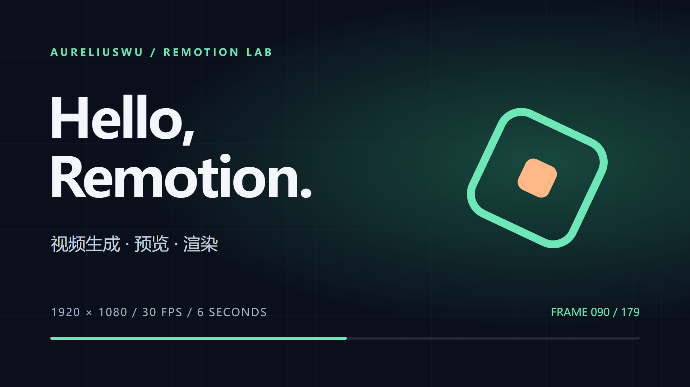

# Remotion 视频生成与渲染联调

本仓库用于联合调试 Remotion，开展基于 Remotion 的视频生成、效果预览与渲染验证。

## 协作范围

- 视频生成：开发和调试视频代码、场景、动画及素材组织。
- 效果预览：检查画面、时间轴、字幕和音频效果。
- 视频渲染：验证视频导出流程，排查渲染失败、性能和输出问题。
- 联合调试：记录可复现的问题、调试过程及验证结果。

## 工程结构

```text
video/                  Remotion + React + TypeScript 工程
  src/Composition.tsx   SmokeTest 测试视频与合成注册
  src/pelican-ride/     鹈鹕海岸骑行：插画、踩踏运动与背景视差
  src/china-genai/     中国生成式 AI 用户规模：数据、分镜与旁白时间轴
  scripts/              规格/静帧/音频验证与本地旁白生成工具
  out/                  本地渲染输出（不纳入 Git）
examples/               已验证的小型测试成片、封面和媒体信息
docs/VALIDATION.md      预览、构建与渲染验证记录
docs/DEPENDENCIES.md    依赖版本、安全公告状态与检查命令
docs/VIDEO-ENGINEERING-LOG.md  制作中的问题、修复、验证与经验
```

## 安装与预览

在终端进入仓库根目录后执行：

```powershell
cd video
npm ci
npm run dev
```

打开终端打印的 Studio 地址，选择 `SmokeTest`。本次使用
`http://localhost:3000/SmokeTest`。在 Codex 中启动且不弹出系统浏览器时，可使用
`npm run dev -- --no-open`。

## 检查与渲染

以下命令在 `video` 目录中执行：

```powershell
npm run check:versions
npm run lint
npm run build
npm run render:test
npm run still:test
```

- `check:versions`：核对 Remotion 配套包和 Zod 等辅助依赖的版本。
- `render:test`：导出 `video/out/smoke-test.mp4`，H.264、1920×1080、30 fps、6 秒。
- `still:test`：导出第 90 帧到 `video/out/smoke-test.png`。
- 首次渲染会自动下载 Chrome Headless Shell，需要网络连接。
- `node_modules`、构建缓存和日常渲染输出均被 Git 忽略。

## 测试视频

### 中国生成式 AI 用户规模

`ChinaGenAiTimeline` 为 1920×1080、60 fps、3600 帧（1 分钟）的数据视频，包含六个独立
分镜及本地合成中文旁白。记录 2024 年 6 月至 2026 年上半年的五个公开人数节点。
资料检索截至 2026-10-29；最新公开统计为 2026 年上半年突破 7 亿人，不推算今天的实时人数。

启动 Studio 后打开 `http://localhost:3000/ChinaGenAiTimeline`，点击播放。


在 `video/` 执行 `npm run verify:genai`，可检查实际合成规格、七个关键帧和六段旁白。
本次交付为可播放预览和静帧，未导出整段 MP4。
[数据来源与口径](docs/CHINA-GENAI-SOURCES.md) ·
[工程问题与经验](docs/VIDEO-ENGINEERING-LOG.md) ·
[自动验证报告](examples/china-genai/validation.json)

### 鹈鹕海岸骑行

`PelicanRide` 是一段暖色海岸插画动画，1920×1080、60 fps、900 帧（15 秒）。
鹈鹕交替踩踏，蹼足保持贴合踏板，车轮旋转，围巾与身体轻微摆动，背景分层滚动。
全部画面由本地 SVG 与逐帧计算生成，无外部素材、无音轨。

启动 Studio 后选择 `PelicanRide`，或打开 `http://localhost:3000/PelicanRide`。
自行车和围巾颜色可通过合成的 `defaultProps` 调整；源文件位于
[`video/src/pelican-ride/`](video/src/pelican-ride/)。


制作与预览验证见[骑行视频说明](docs/PELICAN-RIDE.md)。

### 基础联调示例

`SmokeTest` 包含英文标题、中文副标题、旋转图形、逐帧计数和进度条；动画由
Remotion 帧数驱动。共 180 帧，没有外部素材或音轨。



[下载测试 MP4](examples/smoke-test.mp4) ·
[查看验证记录](docs/VALIDATION.md) ·
[媒体信息](examples/media-info.json)

## 依赖说明

- Remotion 及其配套包固定为 `4.0.539`，通过 `package-lock.json` 锁定依赖。
- Zod 直接固定为 Remotion 当前推荐的 `4.5.4`，已移除此前强制使用 `4.6.6` 的
  `overrides`。保留 Remotion 版本检查，不修改上游检查代码。
- 此前用于覆盖 Zod 的安全公告来源 `CVE-2023-54404` 已被 CNA 拒绝；GitHub 公告与
  npm 审计尚未同步。本轮审计仍为 `10 high`，唯一公告对象为该 CVE 对应的 GHSA。
  本工程保留实际审计结果，不宣称漏洞数量为 0。原始证据、时间和
  [审计摘要](docs/dependency-audit.json)见[依赖说明](docs/DEPENDENCIES.md)。
- 恢复官方依赖后的干净安装、原生版本检查、代码检查、构建、Studio 预览、MP4 与静帧
  渲染均已重新验证通过，渲染日志不再输出 Zod 版本差异提示。本轮结果见
  [验证记录](docs/VALIDATION.md)。
- 中文使用系统字体回退；本轮在 Windows 微软雅黑环境验证。跨平台字体外观可能不同。
