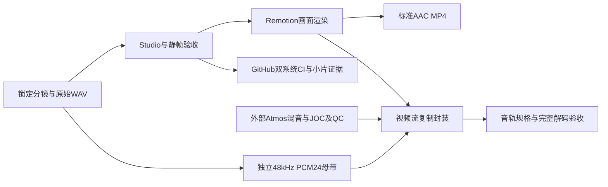

# Remotion本地与GitHub工作流

`video/`是唯一npm工程根，版本固定为Remotion 4.0.539。作品与音频不因流程整理迁移或覆盖。
新闻三期由 `video/workflow.config.json` 登记：`daily-ten`、`weekly-ten`、`ai-weekly`。
平台为 `bilibili`（1920×1080）与 `douyin`（1080×1920），当前均180秒、60fps。
其他既有作品仍使用各自制作命令和Studio入口。

## 一次制作的顺序

1. 核验资料和日期，编辑独立模块里的 `storyboard.json`，锁定旁白及分镜时槽。
2. 本地生成旁白，保留原始浮点WAV和逐句字幕；改动旁白后重新生成清单。
3. Studio预览，执行内容、类型、构建、真实静帧和源音频检查。
4. 明确需要导出时运行完整渲染；也可显式渲染部分帧作调试，文件名和报告会标注partial。
5. 选择标准AAC、PCM24无损封装或外部Atmos分支，再验收实际输出。
6. 分支推送与PR触发GitHub矩阵CI，核对实际提交SHA、两个系统的结果和小体积证据。

## 本地命令



所有命令在 `video/` 中执行，参数错误会失败，未知作品与跨目录作品名会被拒绝。

```powershell
npm ci
npm run browser:ensure
npm run workflow -- doctor
npm run workflow -- list
npm run workflow -- check --edition all
npm run workflow -- preview --edition ai-weekly --platform douyin
```

`doctor`只诊断，不自动下载。`browser:ensure`是显式安装匹配浏览器的步骤。
`check`统一执行版本、ESLint/TypeScript、Node流程与媒体fixture、构建及三期内容检查；不生成整片。
`preview`运行Studio并给出目标合成URL，已有服务可直接打开URL。

```powershell
npm run workflow -- audio --edition ai-weekly --check
npm run workflow -- audio --edition ai-weekly
npm run workflow -- qa --edition ai-weekly --platform all --quick
npm run workflow -- qa --edition ai-weekly --platform all
npm run workflow -- render --edition ai-weekly --platform all --hardware if-possible --concurrency 4
```

`quick`每版3帧；完整QA逐条抽取两段正文并检查源音频。音频工具复用现有Python隔离环境，
也可将 `REMOTION_PYTHON` 设为已有运行时的绝对路径。不能把任意系统Python当作已经配置好TTS。
Daily Ten旧音频生成器没有只读 `--check`，统一入口会明确拒绝该组合，改用内容检查。
缺模型/缓存时按现有 [TTS说明](../video/scripts/ai-history-tts/README.md) 配置；CI不下载TTS模型。

```powershell
# 显式局部渲染，只验收这120帧，不冒称完整成片。
npm run workflow -- render --edition ai-weekly --platform all --frames 0-119 --hardware disable --concurrency 2
```

新标准导出统一进入 `out/workflow-renders/<edition>/standard/`。
局部导出位于 `out/workflow-renders/<edition>/partial-<range>/`。
旧 `render:ai-weekly` / `render:weekly-ten` 命令作为兼容入口调用同一渲染器，输出也进入新目录。
此前直接位于 `out/` 的成片保留。硬件参数只接受 `disable`、`if-possible`、`required`；CI采用软件编码。

## PCM24无损分支

```powershell
npm run workflow -- master --edition ai-weekly --check
npm run workflow -- master --edition ai-weekly
npm run workflow -- package --edition ai-weekly --platform bilibili --profile hires-pcm --source out/ai-weekly-20261030-bilibili-1080p60.mp4
npm run workflow -- package --edition ai-weekly --platform douyin --profile hires-pcm --source out/ai-weekly-20261030-douyin-1080p60.mp4
```

母带从原始句缓存的浮点样本重建，保留原归一化增益、句间0.2秒、每场0.6秒起播、旁白音量0.88及音乐淡入淡出。
音乐按原确定性函数以48kHz重新合成，避免从MP3或旧PCM16配乐再加工。
输出 `out/<edition>-master/master-48k24.wav` 与完整清单，精确180秒，每声道8,640,000个采样帧。
`--check`仅通过计划检查，状态为 `plan_ready`、`masterVerified:false`，不写母带。
缓存缺失、源哈希变化或旁白越界均失败；不会隐式启动付费语音或重新下载模型。

当前旁白原生24kHz，成片48kHz/24bit属于交付格式转换，不增加原声频率信息。
清单明确标注 `resampled:true`、`nativeHiRes:false`、`layout:dual-mono`；不把复制为双声道称为空间混音。
要提高原生解析度，应先采用更高采样率的原始声源。

当前Remotion公开音频编码及内部混音不能直接保留完整24bit制作链路，因此母带独立于其音频输出制作。
封装源片必须有同名 `.audio-validation.json`（标准完整渲染自动生成），其中的作品名、视频SHA、
原稿和配音清单SHA须与当前期一致，避免把同规格的其他视频配上本期旁白。
母带清单的全部原始输入在封装前后重新核对，改过配音或原句样本就必须重建母带。
项目自带FFmpeg可编码PCM24并封装MOV；FLAC/ALAC需要另接具备相应能力的编码器。
PCM24视频保存在 `out/workflow-packages/<edition>/hires-pcm/`，标准MP4不会被覆盖。
封装后完整解码、核验48kHz/24bit/双声道，并比较10800个原视频包的SHA，确认画面未经重编码。
平台标记与投稿后转码识别须另行验证，文件参数通过不等于原生高解析录音认证。

## 外部Atmos分支

Atmos母版与编码需要合适的外部音频工具。本工程只接收真实外部E-AC-3 JOC成品及原始QC证据；
不通过复制声道、提高码率或普通E-AC-3编码假造Atmos。
不要将Atmos成品再放回 `<Audio>` 混音；后续只复制其压缩音轨封装。

```powershell
npm run workflow -- package --edition ai-weekly --platform bilibili --profile atmos --source out/ai-weekly-20261030-bilibili-1080p60.mp4 --audio out/external-atmos.eac3 --atmos-evidence out/external-atmos-qc.json
```

输入须为完整180秒，E-AC-3、6或8声道、码率至少320kbps，另须实际JOC/QC证据。
证据JSON契约如下，音轨索引指最终文件（本流程通常视频0、音频1）：

```json
{
  "schema": "remotion-atmos-qc/v1",
  "audioStreamIndex": 1,
  "audioTrackSha256": "actual-compressed-packet-stream-sha256",
  "qc": {
    "tool": "Dolby Stream Validator",
    "version": "actual-tool-version",
    "status": "passed",
    "originalReportFile": "original-dolby-qc-report.txt",
    "originalReportSha256": "actual-original-report-sha256"
  }
}
```

验收器逐包计算压缩音轨SHA，核对原报告文件和哈希，要求原报告明确JOC与验证通过，缺失或写明No JOC即失败。
该契约核对报告完整性和明确结论，不认证第三方报告出具者身份。真实Atmos正例需外部工具验收和设备回放，
当前只有拒绝假Atmos的fixture测试，不声称已制作或平台验收Atmos。

## GitHub联合调试

`.github/workflows/ci.yml` 保留main推送/PR触发，增加手动触发，矩阵为Windows与Ubuntu 24.04。
Node24/npm ci、匹配浏览器、统一check、AI两版各3帧真实1080p QA和4秒CPU H.264/AAC全解码在两系统运行。
轻量Python fixture使用固定numpy/soundfile，不依赖本地大模型或原始音频缓存。

CI只上传失败日志、小JSON、抽样PNG及4秒MP4，保留7天；不上传整片、bundle、PCM母带或TTS模型。
不配置自托管runner，不把本地GPU/语音缓存暴露给远程任务。
GitHub结果必须绑定具体head SHA；push成功、静帧成功、局部渲染成功都不能替代完整成片验收。
字体随系统不同可产生差异，CI不以Windows PNG哈希要求Linux排版逐像素一致。

本地命令执行记录：`out/workflow/<time-action-pid>/report.json` 和各阶段原始日志。
Node负向fixture会故意产生 `failed` 的拒绝报告；其是否符合预期由测试断言和统一check的退出状态确认，原始报告仍保留。
CI小片：`out/workflow-ci/smoke.mp4` / `report.json`。失败报告写 `failed`，避免遗留PASS被误用。
大文件和运行环境继续留在被忽略的 `out/`，必要验收摘要保存在 `examples/workflow/`。

Windows检出的JSON曾因CRLF导致旁白原稿哈希不一致。本轮恢复与备份SHA一致的原始LF字节，
并通过根 `.gitattributes` 固定JSON、源码和字幕为LF，继续保留严格字节哈希验证。

## 回退与维护

旧视频及音频缓存未清理。回退代码使用本轮分支前的远端基线，或在PR上回退本轮提交；
不要用递归删除整个 `out/` 代替回退。改新一期时先复制独立模块和资产目录，再添加registry条目及来源说明。
本轮备份：`video/out/workflow-preflight-20261031/pending-work.zip` 与逐文件SHA清单。
本地基线为 `b23ff70`，远端接入基线为 `28c2efa`；实际提交与CI结果见本轮联调记录。
